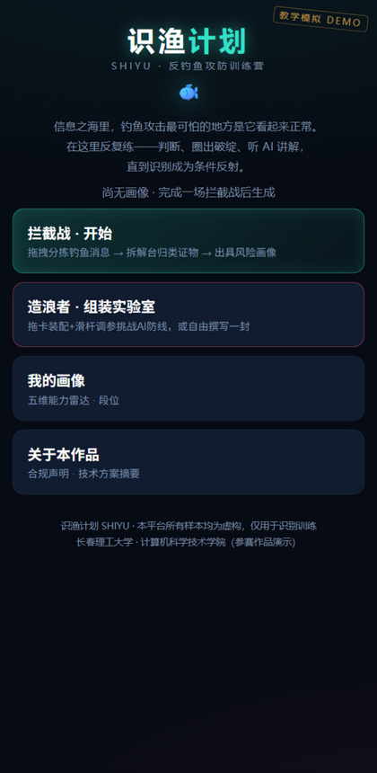
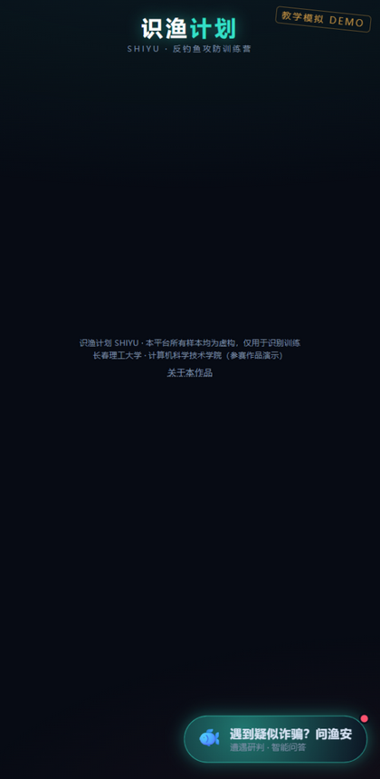
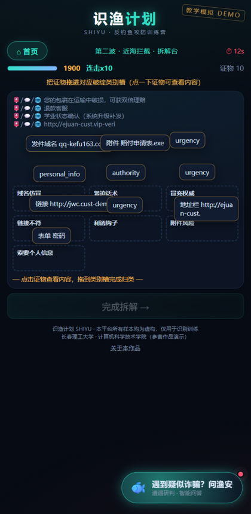
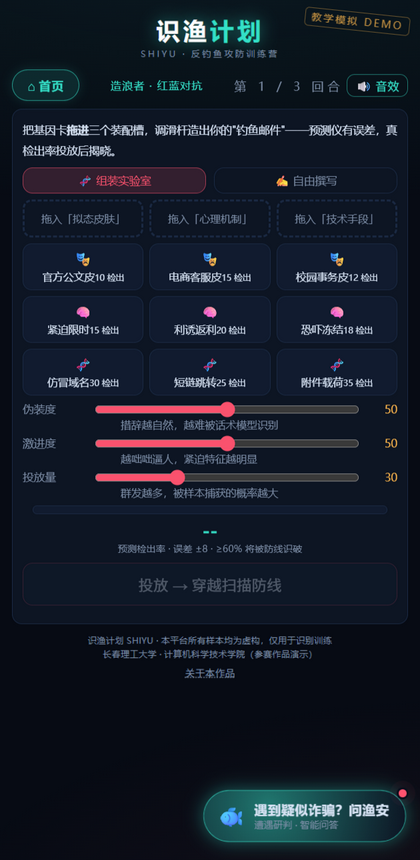
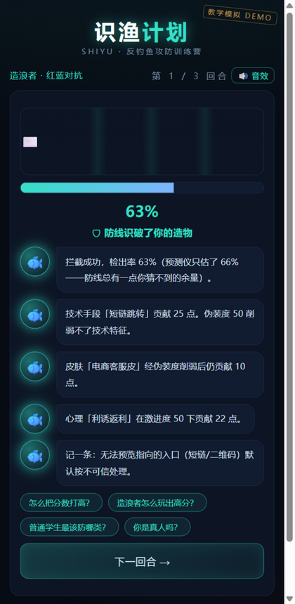
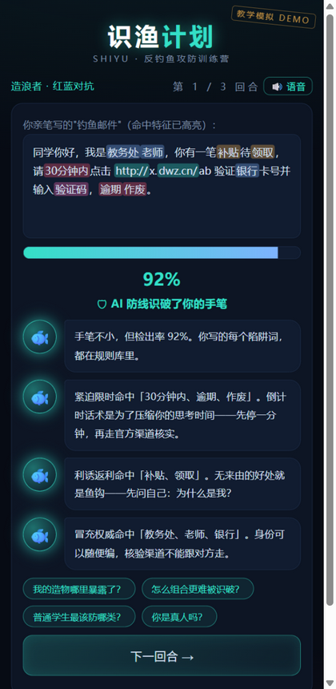
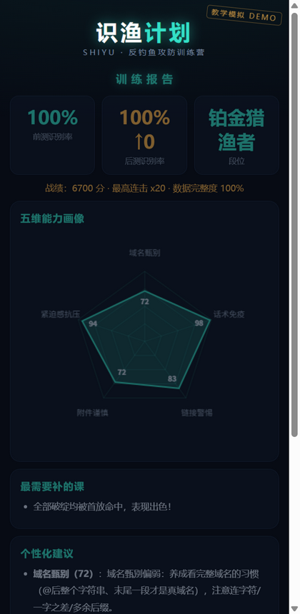
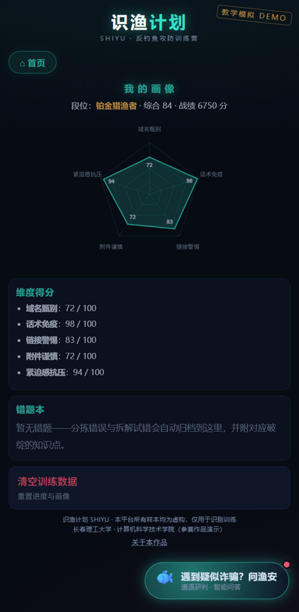

# 识渔计划 · 反钓鱼攻防训练营

> **SHIYU — Anti-Phishing Trainer**
> 一个运行在手机浏览器里的反钓鱼诈骗训练游戏：在仿真邮件、短信、链接页中反复练习识别钓鱼攻击，逐条讲解每一处误判，练完生成个人「受骗风险画像」。

第十四届全国大学生数字媒体科技作品及创意竞赛 · **移动与网络应用开发类赛项** 参赛作品
长春理工大学 · 计算机科学技术学院

纯前端实现，零后端、零外部依赖、离线可运行 —— 浏览器打开即玩，免安装、免注册。

## 待办事项（提交前必做）

> [!IMPORTANT]
> 报名及作品提交**截止 2026-10-23 23:59:59**，以截止前最后一次成功提交版本为准；仅保存草稿不算提交。
> 下列标 ⛔ 的项**未完成就无法提交**，请优先处理。逐条对照见 [`docs/06-参赛材料清单与要求对照.md`](docs/06-参赛材料清单与要求对照.md)。

| 优先级 | 待办 | 说明 | 关联文件 |
|---|---|---|---|
| ⛔ 必做 | **队伍信息定稿** | 队伍名称、成员（≤ 5 人）、指导教师（1–2 名）替换全部占位符［待定稿］ | `README.md` §十五、`docs/01`、`docs/02`、`docs/03`、`docs/05` |
| ⛔ 必做 | **部署 HTTPS 访问链接** | 把 `webapp/` 整目录传到静态托管（GitHub Pages / 校园服务器 / 对象存储），生成二维码，把链接填进申报书「访问方式」 | [`webapp/`](webapp/) |
| ⛔ 必做 | **录制演示视频（3–5 分钟）** | 按分镜脚本真机录制：拦截战 → 拆解台 → 组装实验室 → 画像 | [`docs/07-演示视频脚本.md`](docs/07-演示视频脚本.md) |
| ⛔ 必做 | **原创性与知识产权声明签字** | 打印 → 团队全员签字 → 指导教师签字 → 按当届格式誊录 | [`docs/05-原创性与知识产权声明.md`](docs/05-原创性与知识产权声明.md) |
| ⛔ 必做 | **AI 工具使用说明誊录** | 勾选「使用」，按报名系统内表格格式誊录，全员签字 | [`docs/04-AI工具使用说明.md`](docs/04-AI工具使用说明.md) |
| ⛔ 必做 | **系统内提交并保存作品编号** | 按《作品材料提交规范》命名打包，确认「提交成功」并记录作品编号 | 竞赛官网 www.cmit.cn |
| 建议 | **补前后测真实数据** | 招募 20–30 名同学跑前测 → 训练 → 后测，把平均提升填进开发文档 §9（已留占位） | [`docs/02-开发文档.md`](docs/02-开发文档.md) §9、附录 C |
| 建议 | 补写测试现场照片等佐证 | 与截图一起作为图像佐证 | [`screenshots/`](screenshots/) |
| 可选 | 接后端大模型 | 让安全官支持自由问答、题库动态生成（前端已预留三个替换点） | [`docs/02-开发文档.md`](docs/02-开发文档.md) §7 |

**已知待优化（工程，不阻塞提交）**：

- 部分破绽靶点写在正文文本锚点（`data-el`）上，拆解台证物标签会回退显示类别键；
- `legitNotes`（正常样本讲解）已在数据层保留，UI 渲染待接入；
- 题库为 20 题精标样本，判分为前端规则引擎（后端化后可换分类器）。

## 目录

- [★ 待办事项（提交前必做）](#待办事项提交前必做)
- [一、作品简介](#一作品简介)
- [二、运行界面（截图）](#二运行界面截图)
- [三、核心功能](#三核心功能)
- [四、目标用户与使用场景](#四目标用户与使用场景)
- [五、业务流程](#五业务流程)
- [六、快速开始](#六快速开始)
- [七、技术架构](#七技术架构)
- [八、项目结构](#八项目结构)
- [九、数据与内容体系](#九数据与内容体系)
- [十、测试说明](#十测试说明)
- [十一、数据安全、隐私与合规](#十一数据安全隐私与合规)
- [十二、创新点](#十二创新点)
- [十三、应用价值与推广](#十三应用价值与推广)
- [十四、参赛信息与提交材料](#十四参赛信息与提交材料)
- [十五、团队](#十五团队)

## 一、作品简介

钓鱼攻击最可怕的地方，是**它看起来正常**。反诈讲座人人听过，但真收到一封「教务处」邮件时，判断靠的是从未被训练过的直觉。

《识渔计划》把这种判断力变成可以反复练习的游戏。作品用一个**攻防双视角**的闭环训练学生：

1. **先防守** —— 在时间压力下把涌入的消息拖进「渔网（钓鱼）」或「收件箱（正常）」（*拦截战*），再把拦下的钓鱼样本拆成证物碎片、拖进七类破绽槽位归类（*拆解台*）；
2. **再进攻** —— 切换到攻击者视角，拖卡装配「拟态皮肤 × 心理机制 × 技术手段」并用滑杆调参，亲手造一封钓鱼邮件去挑战内置 AI 防线（*造浪者·组装实验室*），或自由撰写一封由规则引擎逐词高亮判检；
3. **全程有反馈** —— AI 蓝军安全官打字机点评 + 本地语音讲评 + 快捷追问；
4. **练完有量化** —— 训练前后测对比，生成五维「受骗风险画像」（域名甄别 / 话术免疫 / 链接警惕 / 附件谨慎 / 紧迫感抗压）、段位与个性化建议。

作品全程离线、零网络请求，样本全部虚构并带「教学模拟」水印，链接不产生真实跳转。

## 二、运行界面（截图）

| 首页 | 拦截战 · 拖拽分拣 |
|---|---|
|  |  |

| 拆解台 · 证物归类 | 造浪者 · 组装实验室 |
|---|---|
|  |  |

| 造浪者 · 投放结算 | 自由撰写 · 规则判检 |
|---|---|
|  |  |

| 训练报告 · 五维雷达 | 我的画像 |
|---|---|
|  |  |

完整截图见 [`screenshots/`](screenshots/)，也可直接运行 [`webapp/`](webapp/) 体验。

## 三、核心功能

### 1. 拦截战（拖拽分拣 · 行为训练）

仿真邮件 / 短信 / 链接页卡片在限时中涌入，玩家把卡片**拖进左侧渔网（钓鱼）或右侧收件箱（正常）**。连击计分、数据完整度血条、超时漏网；键盘 `←` / `→` 亦可分拣。用真实的时间压力复现受骗情境。

### 2. 拆解台（证物归类 · 知识内化）

把拦截下的钓鱼样本拆成「证物碎片」（仿冒域名、短链、紧迫话术、附件、二维码……），**拖进七类破绽槽位**完成归类；首放命中计分、放错弹回并讲解，每件证物的归属与理由逐条展开。

七类破绽：域名仿冒 · 紧迫话术 · 冒充权威 · 链接不符 · 利诱钩子 · 附件风险 · 索要个人信息。

### 3. 造浪者 · 组装实验室（红蓝对抗 · 攻击者视角）

拖着 9 张「基因卡」（拟态皮肤 × 心理机制 × 技术手段）进装配槽，用三根滑杆连续调节 **伪装度 / 激进度 / 投放量**；预测仪给出带 **±8 误差**的检出率预测，投放后邮件飞越扫描光束揭晓真实检出率。也可**自由撰写**一封钓鱼邮件，由六类正则规则引擎（紧迫限时 / 利诱返利 / 冒充权威 / 索要敏感信息 / 可疑链接 / 附件诱导）逐词高亮判检。

### 4. AI 蓝军安全官 + 风险画像

全程打字机点评、浏览器本地语音播报（可开关）、快捷追问（本地知识库作答）。训练结束生成五维能力雷达、段位与个性化建议。

## 四、目标用户与使用场景

| 层级 | 对象 | 使用场景 |
|---|---|---|
| 直接用户 | 在校大学生，重点为大一新生 | 个人自测、宿舍 / 班级对抗赛 |
| 推广用户 | 高校保卫处、辅导员 | 新生安全教育月组织班级演练（匿名成绩汇总即演练报告） |
| 延伸用户 | 中学信息科技教师 | 网络安全 / AI 素养课堂教学具 |

目标用户明确：**缺乏校园类钓鱼辨识经验的新生**。使用场景明确：**扫码即玩、免安装、可在校园网内网离线部署**。

## 五、业务流程

```
首页
 ├─ 拦截战（四波战役：前测侦察 → 近海拦截 → 深水区 → 终局后测，共 20 个虚构样本）
 │    ├─ 发牌 → 限时 → 拖拽分拣（渔网 / 收件箱）→ 连击 / 血量 / 超时结算
 │    └─ 每波拦截后 → 拆解台（证物拖进七类破绽槽 → 判定 → 逐条讲解）
 ├─ 造浪者 · 红蓝对抗（最多 3 回合）
 │    ├─ 组装实验室（拖卡装配 + 滑杆调参 → 预测仪 ±8 → 投放 → 扫描光束 → 真实检出率）
 │    └─ 自由撰写（自写钓鱼邮件 → 规则引擎高亮命中 → 判检与讲评）
 └─ 训练报告 / 我的画像（前后测对比 · 五维雷达 · 段位 · 薄弱项 · 个性化建议）
```

训练闭环设计：**前测（摸清基线）→ 训练（拦截 + 拆解）→ 后测（同难度不同题）→ 画像（量化提升）**。

## 六、快速开始

**方式一（Windows，最快）**：双击根目录 [`启动识渔计划.bat`](启动识渔计划.bat)，脚本会自动启动本地静态服务并打开浏览器。

**方式二（任意系统）**：

```bash
cd webapp
python -m http.server 8765
# 浏览器访问 http://127.0.0.1:8765（建议手机竖屏，或浏览器开发者工具切换移动视口）
```

**方式三（部署）**：把 `webapp/` 整目录上传到任意静态托管（校园服务器 / GitHub Pages / 对象存储），入口 `index.html`，建议启用 HTTPS 后用二维码作为入口。无构建步骤、无环境要求。

> 注意：请勿用 `file://` 直接双击 `index.html`（部分浏览器会限制 localStorage 与语音），走本地服务器即可。

**校验题库数据（可选）**：

```bash
node tools/validate.js
```

## 七、技术架构

当前为「演示最优」的纯静态前端形态：单页应用（原生 JS，无框架、无构建链），部署成本趋近于零，离线可运行。

| 层 | 文件 | 职责 |
|---|---|---|
| 页面骨架 | `webapp/index.html` | 首页 / 拦截战 / 报告 / 造浪者 / 画像 / 关于 |
| 样式与动效 | `webapp/styles.css` | 深色科技风；拖拽吸附、槽位高亮、扫描光束、连击弹字等关键帧 |
| **数据层** | `webapp/data.js` | 20 个虚构样本（含破绽标注）、战役波次编排、9 张基因卡、五维 / 类别常量、段位 |
| **逻辑层** | `webapp/app.js` | 拦截战状态机、拆解台拖放、组装实验室、安全官、雷达图、本地存档 |
| 工具 | `tools/validate.js` | 题库数据完整性静态校验（靶点 / 维度映射 / 战役队列） |

关键设计：

- **数据与逻辑完全分离**：加题 / 改题只动 `data.js`，不碰逻辑（样本 Schema 见 [`webapp/README.md`](webapp/README.md)）；
- **统一指针事件拖拽模型**：拦截卡 / 证物 / 基因卡三套拖拽复用同一模式，命中判定以指针坐标落点（`slotAtPoint`）为准，触屏与鼠标一致；
- **判定引擎**：拦截战 = 限时决策结算；拆解台 = 七类破绽的首放命中 / 试错计分；组装实验室 = 「基因基础检出 + 滑杆连续调制 + 预测仪噪声」的非线性对抗模型；自由撰写 = 六类正则规则引擎；
- **能力模型**：破绽类别 → 五维能力维度映射，前后测对比 + Canvas 手绘雷达图；
- **本地能力**：音效由 WebAudio 实时合成（无音频素材文件），语音采用浏览器本地 TTS，**无任何 API Key、无外部网络请求**；
- **本地存档**：进度与画像仅存 `localStorage`，匿名、不上传。

**后端化预留**（见 [`docs/02-开发文档.md`](docs/02-开发文档.md) §7）：话术出口 `Officer.play(script)` / `OFFICER_QA` 可替换为大模型流式接口；`launchAttack` 检出公式可替换为服务端分类器；固定题库 `CAMPAIGN` 可接「每日挑战」生成管线 —— 前端交互层无需改动。

## 八、项目结构

```
shiyu-anti-phishing-trainer/
├── README.md                     ← 本文件（作品总说明）
├── 启动识渔计划.bat              ← Windows 一键启动
├── docs/                         ← 参赛文档
│   ├── 00-项目交接说明.md         ← 拿到包的入口
│   ├── 01-作品申报书.md           ← 作品说明 + 附录
│   ├── 02-开发文档.md             ← 产品设计 / 架构 / 排期 / 评测方案
│   ├── 03-系统说明书.md           ← 系统说明 · 功能演示 · 技术架构 · 测试说明
│   ├── 04-AI工具使用说明.md       ← 按竞赛第十条要求的要素
│   ├── 05-原创性与知识产权声明.md  ← 声明模板（签字后提交）
│   ├── 06-参赛材料清单与要求对照.md
│   └── 07-演示视频脚本.md         ← 3–5 分钟分镜
├── screenshots/                  ← 各界面截图（答辩 / 佐证素材）
├── tools/
│   └── validate.js               ← 题库数据校验脚本
└── webapp/                       ← 全部源码（纯静态，可直接部署）
    ├── index.html / styles.css / data.js / app.js
    └── README.md                 ← 前端技术说明
```

## 九、数据与内容体系

- **样本库**：20 个虚构样本（邮件 9 / 短信 6 / 链接页 5），三档难度，覆盖奖助学金、快递理赔、冒充导师、账号异常、退款赔付、中奖等高校高发场景；
- **破绽体系**：7 类破绽，逐条标注类别、靶点与讲解文案；
- **能力模型**：5 个维度（域名甄别 / 话术免疫 / 链接警惕 / 附件谨慎 / 紧迫感抗压）；
- **基因卡**：9 张（拟态皮肤 ×3、心理机制 ×3、技术手段 ×3），每张含基础检出分与对应防御知识；
- **段位**：青铜识路人 → 白银查链接 → 黄金破话术 → 铂金猎渔者 → 王者防线。

`node tools/validate.js` 会校验样本 id、破绽靶点、能力维度映射、基因卡与战役队列的一致性。

## 十、测试说明

**已做的验证**：

- JS 语法检查：`node --check data.js` / `node --check app.js` 通过；
- 题库数据校验：`node tools/validate.js` 通过（20 个样本的破绽靶点、维度映射、基因卡、战役队列全部可解析，无重复 / 悬空引用）；
- 交付前回归（交接时记录）：浏览器全流程 —— 四波分拣（含连击 / 血量 / 超时路径）、拆解台证物归位、组装实验室拖卡 + 滑杆实时预测 + 投放噪声结算、自由撰写命中高亮、报告 / 雷达 / 画像、语音与追问。

**兼容性**：Chrome / Edge / Safari 现代版本。语音（Web Speech）在部分 Linux 浏览器不可用，会自动静默降级为纯文字。

**已知限制**：

- 题库为 20 题精标样本，「每日挑战」动态出题需接后端 LLM 管线；
- 判分为前端规则引擎，后端化后可替换为自建数据集训练的分类器；
- 语音为浏览器本地 TTS，音色依系统而定；
- 部分破绽靶点写在正文文本锚点（`data-el`）上，拆解台证物标签会回退显示类别键，为已知表现。

## 十一、数据安全、隐私与合规

按赛项要求「涉及用户信息、网络通信、数据存储和智能算法的，应具有基本的数据安全、隐私保护和合规意识」，作品将合规内建为玩法：

- **教学模拟定位**：界面全程带「教学模拟」水印，不提供任何消息发送 / 转发能力；
- **全虚构原则**：发件人、机构、域名均为虚构，所有链接仅指向产品内本地演示页，不产生真实跳转；
- **免登录匿名**：不采集任何个人身份信息，作答数据仅存用户浏览器本地（`localStorage`），不上传、不联网；
- **零外部依赖**：运行时不发起任何外部网络请求，无第三方追踪、无 API Key；
- **AI 使用透明**：按竞赛要求提交《AI 工具使用说明》，说明生成式 AI 在代码辅助环节的使用范围与人工审核流程（见 [`docs/04-AI工具使用说明.md`](docs/04-AI工具使用说明.md)）。

## 十二、创新点

1. **攻防双视角训练法**：先防守（拦截 / 拆解）再进攻（造浪者），在纯沙箱内从攻击者视角反推防御直觉；
2. **证物化拆解交互**：把「圈出可疑之处」升级为「把证物碎片拖进类别槽」，归类动作本身即知识结构化的过程；
3. **带误差的对抗预测**：预测仪显示 ±8 区间、投放加噪声结算，抑制穷举最优解，保留博弈感；
4. **连续参数空间**：滑杆调参让「攻击构造」从离散选卡变为连续权衡（伪装度 × 激进度 × 投放量非线性耦合）；
5. **零依赖 AI 角色**：安全官的点评 / 追问 / 语音全部本地生成，演示零网络零延迟，同时预留大模型升级位；
6. **合规内建为玩法**：全虚构样本、禁真实跳转、教学模拟水印、匿名本地存档 —— 安全护栏是产品设计而非事后补丁。

## 十三、应用价值与推广

- **对个人**：把「听过反诈宣传」变成「识别率实测提升」，报告直接给出前后测变化与薄弱维度；
- **对学校**：为新生安全教育提供可组织、可量化的演练工具，匿名汇总即班级演练报告；
- **对课堂**：中学信息科技 / AI 素养课的网络安全单元教学具（拆解台即教具）；
- **推广形态**：单文件级部署门槛（任意静态托管），支持校园网内网离线部署；后续接后端可扩展班级看板、每日挑战、真实前后测数据集。

## 十四、参赛信息与提交材料

| 项 | 内容 |
|---|---|
| 竞赛 | 2026 年第十四届全国大学生数字媒体科技作品及创意竞赛 |
| 赛道 | 移动与网络应用开发类赛项（自主选题类） |
| 作品形态 | 移动端 H5 互动游戏（浏览器即开即玩，离线可运行） |
| 竞赛官网 | www.cmit.cn |
| 报名及作品提交截止 | **2026-10-23 23:59:59** |

基本申报材料（按赛项要求）与本仓库对应关系：

| 材料 | 状态 | 位置 |
|---|---|---|
| 可运行 / 可访问作品本体 | 已具备 | [`webapp/`](webapp/)（HTTPS 链接待部署后填写） |
| 作品说明文档 | 已具备 | [`docs/01-作品申报书.md`](docs/01-作品申报书.md)、[`docs/02-开发文档.md`](docs/02-开发文档.md)、[`docs/03-系统说明书.md`](docs/03-系统说明书.md) |
| 功能演示（截图 / 录屏） | 截图已完成 / 视频待录制 | [`screenshots/`](screenshots/)、[`docs/07-演示视频脚本.md`](docs/07-演示视频脚本.md) |
| 原创性与知识产权声明 | 模板已备 / 待签字 | [`docs/05-原创性与知识产权声明.md`](docs/05-原创性与知识产权声明.md) |
| AI 工具使用情况说明 | 已具备 | [`docs/04-AI工具使用说明.md`](docs/04-AI工具使用说明.md) |
| 技术架构与测试说明 | 已具备 | 本文件第七、十节；[`docs/03-系统说明书.md`](docs/03-系统说明书.md) |

材料清单与竞赛要求的逐条对照见 [`docs/06-参赛材料清单与要求对照.md`](docs/06-参赛材料清单与要求对照.md)。

## 十五、团队

长春理工大学 · 计算机科学技术学院 —— ［队伍名称 / 成员 / 指导教师 待定稿］

本仓库为参赛作品公开仓库；作品知识产权归参赛团队及所在学校，按学校相关规定享有。作品不含第三方版权素材。
